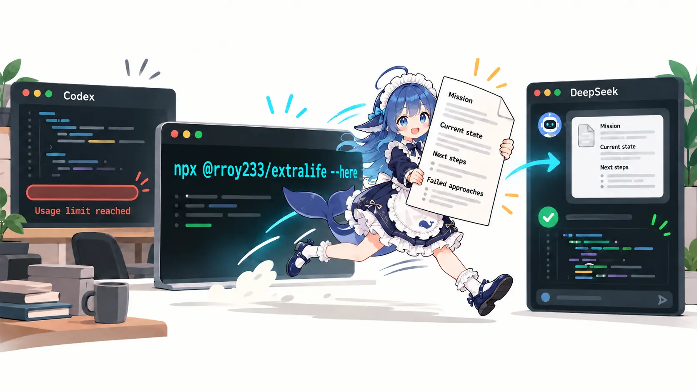
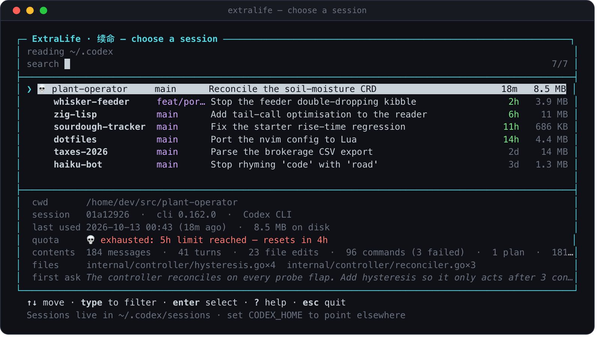
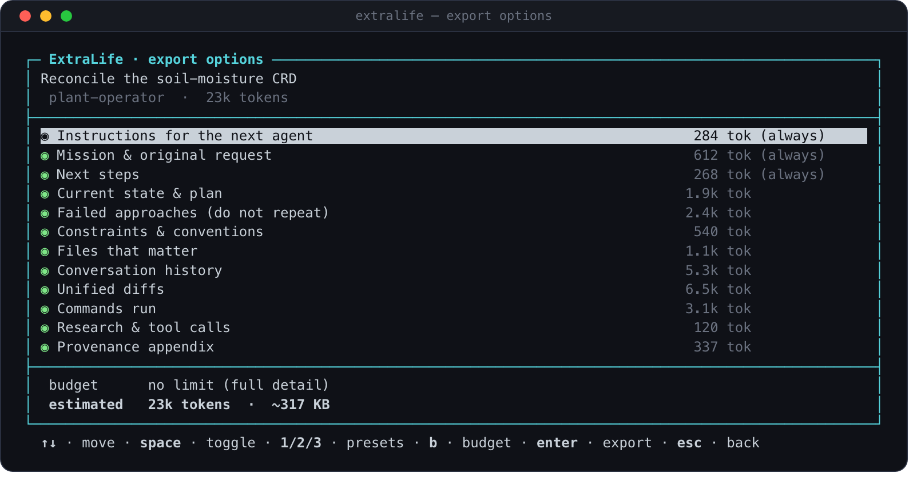
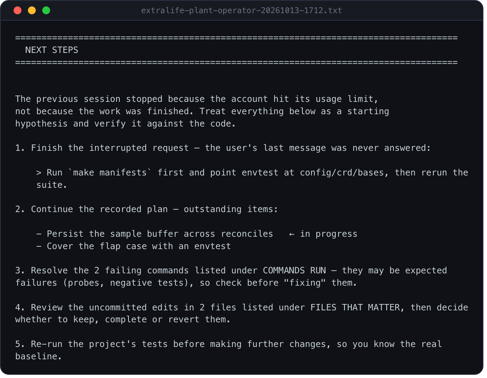

<div align="right">

[English](README.md) | [中文](README.zh.md) 

</div>

<div align="center">

# ExtraLife

**When your Codex usage limit is reached, turn the current session into a handoff brief that another AI tool can continue from.**

ExtraLife extracts the task goals, current progress, next steps, failed attempts, and important files from your local Codex sessions, then generates a handoff document that is easy for another AI tool to pick up and continue.



```bash
npx @rroy233/extralife --here
```

[](docs/reference.md#installation)
[](LICENSE)

</div>

## Features

- Browse Codex sessions and view usage-limit status. Narrow the scope to the current project or directory, or include archived sessions.
- Export task goals, work progress, next steps, failed attempts, file changes, command history, and conversation summaries.
- Mark whether content comes directly from session records or is inferred from context, making it easier for the next tool or user to verify.
- Support plain text, Markdown, and JSON output, with configurable content, level of detail, and token budget.
- Clean common credentials by default. Session data is processed locally and is neither uploaded nor used for telemetry.
- Use the generated document with Codex, Claude Code, Cursor, Gemini, DeepSeek, or other AI tools to continue the work.

## Quick Start

Node.js 18 or later is required. From your project directory, run:

```bash
npx @rroy233/extralife --here
```

Then follow the steps below to select a session, configure the export, and generate the handoff document.

### 1. Select a Session

The list shows the project, branch, recent activity, and usage-limit status. Select the session you want to hand off to view its details.

<div align="center">

</div>

### 2. Choose What to Export

Select the content you need, such as task status, next steps, failed attempts, and file changes. You can also adjust the level of detail and token budget.

<div align="center">

</div>

### 3. Hand It Off to Another AI Tool

The exported document organizes the current progress and next steps so another AI tool can continue the work.

<div align="center">

</div>

If you do not need interactive selection, you can directly export the most recent session for the current project and copy it to the clipboard:

```bash
npx @rroy233/extralife --here -y --copy
```

For more commands, export formats, and privacy details, see the [Command Reference](docs/reference.md). Reading compressed sessions requires Node.js 22.15 or later.

## Privacy

ExtraLife reads Codex sessions locally. Credential cleaning is enabled by default; review the generated document before sharing it. Do not publicly share raw session files, private project code, or credentials.

## License

MIT. See [LICENSE](LICENSE) for details. ExtraLife is not affiliated with OpenAI; “Codex” refers to OpenAI's coding agent.
